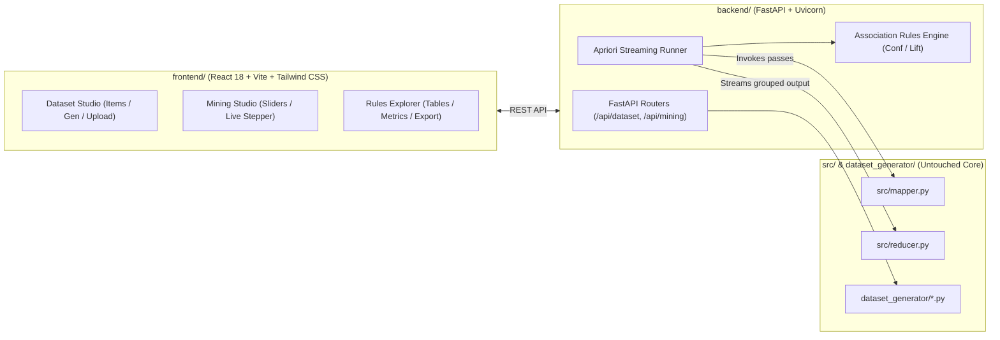

# Market Basket Analysis Web Application Design Specification

- **Date**: 2026-10-30
- **Status**: Approved
- **Topic**: Market Basket Analysis Interactive Web Application (FastAPI + React/Tailwind)

---

## 1. System Overview & Objectives

The goal is to provide a modern, interactive web application for Market Basket Analysis that eliminates the need to run and monitor terminal commands manually. 

### Key Principles
1. **Preserve Existing Hadoop Infrastructure**: All existing scripts in `src/` (`hadoop_apriori.py`, `mapper.py`, `reducer.py`, `nextpass.py`, `reset.py`) and `dataset_generator/` remain intact and functional for terminal/Hadoop cluster runs.
2. **Dual-Mode Execution**:
   - **Local Streaming Mode (Default)**: Executes streaming MapReduce passes on the server machine through pipes mimicking Hadoop Streaming without needing Hadoop installed.
   - **Hadoop Cluster Mode**: Retains ability to execute via Hadoop Streaming JAR on an active cluster when configured.
3. **End-to-End Suite**: Includes Item Inventory Management, Synthetic Dataset Generation, Custom CSV/JSON Transaction Upload, Real-Time MapReduce Pass Stepper, and Association Rule Mining (Support, Confidence, Lift).

---

## 2. Architecture & Components



### Folder Layout
```
Python_Hadoop_MapReduce_MarketBasketAnalysis/
├── backend/
│   ├── app/
│   │   ├── __init__.py
│   │   ├── main.py              # FastAPI app & CORS configuration
│   │   ├── models.py            # Pydantic models for API requests/responses
│   │   ├── services/
│   │   │   ├── __init__.py
│   │   │   ├── dataset_service.py # Item management, generator integration, file upload
│   │   │   ├── apriori_runner.py  # Multi-pass MapReduce streaming executor
│   │   │   └── rules_engine.py    # Generates association rules with Support, Confidence, Lift
│   │   └── routers/
│   │       ├── __init__.py
│   │       ├── dataset.py       # Dataset endpoints
│   │       └── mining.py        # Mining job & results endpoints
│   ├── requirements.txt         # fastapi, uvicorn, pydantic, python-multipart
│   └── run.py                   # Backend entrypoint launcher
├── frontend/
│   ├── src/
│   │   ├── components/
│   │   │   ├── Navbar.jsx
│   │   │   ├── DatasetStudio.jsx
│   │   │   ├── MiningStudio.jsx
│   │   │   ├── FrequentItemsetsView.jsx
│   │   │   ├── RulesExplorer.jsx
│   │   │   └── SummaryCards.jsx
│   │   ├── services/
│   │   │   └── api.js
│   │   ├── App.jsx
│   │   ├── main.jsx
│   │   └── index.css
│   ├── index.html
│   ├── package.json
│   ├── vite.config.js
│   └── tailwind.config.js
├── src/                         # Untouched core Hadoop / Apriori scripts
├── dataset_generator/           # Untouched core dataset generator
└── tests/
    ├── test_streaming.py        # Existing tests
    └── test_backend.py          # Web API & rules engine tests
```

---

## 3. Data Flow & Execution Specifications

### 3.1 Dataset Management
1. **Items**: Read/write to `dataset_generator/items/item_list.json` via `dataset_service.py`.
2. **Synthetic Generation**: Calls `dataset_generator/generate_dataset.py` and `dataset_generator/generate_csvdataset.py` programmatically.
3. **Uploads**: User uploads `.csv` (comma-separated items per line) or `.json` (array of string arrays). Stored in a temporary dataset directory with preview capabilities (first 10 rows, transaction count, distinct item count).

### 3.2 Apriori MapReduce Streaming Execution
1. Asynchronous job launched with `min_support` (count or %), `min_confidence` (%), and `max_itemset_length`.
2. For each pass $k = 1, 2, \dots$:
   - Passes are executed by invoking `src/mapper.py` with `--itemset-length k` and current pruned itemset state.
   - Output lines are sorted by key.
   - Sorted stream is piped to `src/reducer.py` with `--minimum-support`.
   - Results are categorized into `"frequent"` and `"discarded"`.
   - Discarded itemsets update the pruning list for pass $k+1$.
   - Pass stats (candidate count, frequent count, pruned count, elapsed time) are recorded in job telemetry.
   - Halts when no frequent itemsets remain or $k$ reaches `max_itemset_length`.

### 3.3 Association Rules Calculation
Given frequent itemsets $L$:
For each frequent itemset $I \in L$ with $|I| \ge 2$:
- Generate all proper non-empty subsets $X \subset I$.
- Consequent $Y = I \setminus X$.
- $\text{Support}(X \implies Y) = \frac{\text{supp}(I)}{N}$
- $\text{Confidence}(X \implies Y) = \frac{\text{supp}(I)}{\text{supp}(X)}$
- $\text{Lift}(X \implies Y) = \frac{\text{Confidence}(X \implies Y)}{\text{Support}(Y)} = \frac{\text{supp}(I) \times N}{\text{supp}(X) \times \text{supp}(Y)}$
- Filter rules where $\text{Confidence} \ge \text{min\_confidence}$.
- Classify Lift:
  - $\text{Lift} > 1.0$: Positive correlation (items co-occur more than chance).
  - $\text{Lift} = 1.0$: Independence.
  - $\text{Lift} < 1.0$: Negative correlation.

---

## 4. Error Handling & Edge Cases

- **Invalid / Empty Files**: Validates lines and transactions before running; returns informative HTTP 400 error.
- **Zero Frequent Itemsets**: When minimum support exceeds all frequencies, completes gracefully with 0 rules and user guidance to lower threshold.
- **Concurrent Mining Jobs**: Jobs are assigned unique UUIDs and run with independent temporary state files, preventing state file corruption.

---

## 5. Verification & Testing

1. **Unit & Integration Tests (`tests/test_backend.py`)**:
   - Test item list additions and retrieval.
   - Test dataset generation and CSV upload parsing.
   - Test multi-pass execution runner and verify mathematical accuracy of Support, Confidence, and Lift.
2. **Frontend Build**:
   - `npm run build` succeeds with zero errors.
3. **End-to-End Test**:
   - Launch backend and frontend, run an analysis on sample data, verify rules output matches mathematical expectations.

